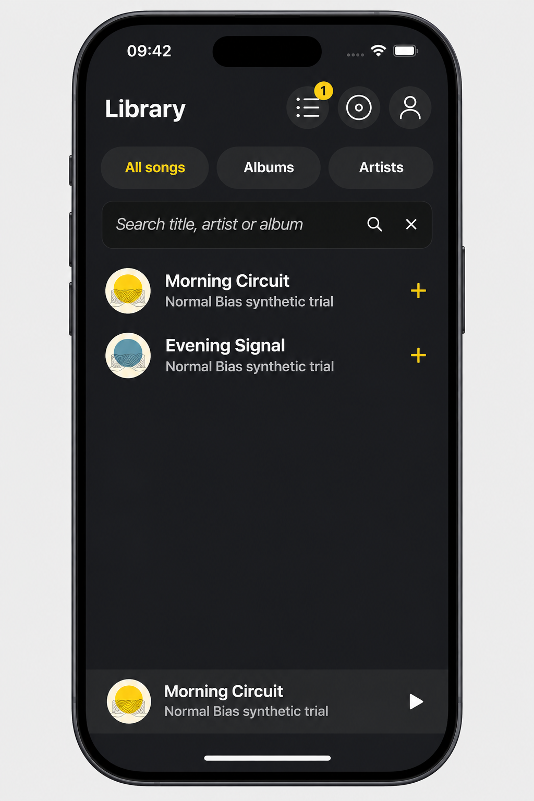
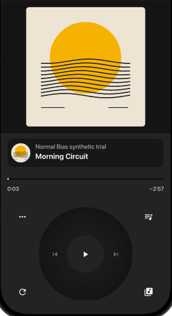

# Normal Bias design reference

Approved design direction, 2026-11-24. This is the canonical design reference for the shared listening application. Read it before planning, changing or verifying UI. The project brief governs product scope; this document governs presentation and interaction consistency. Earlier proposals are historical where superseded here. Reuse the existing Java/Codename One components and pinned 7.0.282 capabilities.

## Principles

Graphite is a tactile personal music device: charcoal surfaces, recessed information wells, a sculpted circular wheel, generous continuous lists and restrained amber details. Artwork supplies most colour. Avoid card-per-track layouts, bright filled transport buttons, unnecessary headings and competing navigation rows. Normal workflows use full-screen views with an explicit way back to their launching context; avoid popups for routine navigation, options and forms. Reserve modal prompts for situations that require an immediate decision. Native conventions apply to fonts, safe areas, keyboard, focus, Back and accessibility; they do not replace the custom player with generic widgets.

Library and Now Playing are the only top-level destinations. Queue belongs to Now Playing and is reached through the dedicated player Queue control. Use separate destinations at every width, including desktop. Navigation changes presentation only: retain the same player, queue, media resource and Library query/group/scroll state. Do not restart audio merely to change views.

## Established tokens and implementation units

| Role | Established value / convention |
| --- | --- |
| Library / form | `#202124` |
| Player body | `#272727` |
| Artwork recess | `#141414` |
| Search / metadata well | `#171717`, `#3D3D3D` rim, 2.5 mm corner radius |
| Main text | `#F3F3F1` |
| Secondary text | `#B7B8BB` |
| Active detail / keyboard focus | `#EAC23F` |
| Decorative seam | `#111111`; subtle upper graphite edge |
| Disabled text | `#77797B` (hardware controls retain existing `#767676`) |
| Mini-player | `#27282B`, `#353638` upper seam |
| Typography | Native regular / bold; body 2.4 mm, track title 2.3 mm, secondary 2 mm, time/status detail 1.8 mm |
| Spacing | Theme uses density-aware mm: 4 mm horizontal content inset, 2–3 mm control/list rhythm; zero opaque structural-container fill |
| Search | 1.5 mm inset, 1 mm top / 2 mm bottom outside spacing |
| Category pills | Existing moulded `LibraryViewButton`, 3 mm × 2 mm padding, 1 mm margin, 2 mm bold text |
| List artwork | Existing circular `RecordArtwork` thumbnail sizing; reuse across list/queue/mini-player |
| Controls | Existing graphite hardware painter; white symbols, amber persistent selection, separate keyboard-focus indication |

These values reconcile the current theme with the approved Graphite direction. The older 8/12/16/24/32 spacing scale, 40–42 artwork and 72–96 list-row measurements describe reference-image proportions, not literal Codename One pixels. Do not copy raster dimensions or web CSS into the theme. Let rows grow for text. Toolbar controls use at least 9 mm touch regions; visually small icons keep a larger hit region. Verify comfortable 44 pt iOS / 48 dp Android-equivalent targets at the actual platform density, readable contrast and no overlap.

## Component and navigation conventions

- **Shared fixed toolbar:** contextual title; Library offers Now Playing and Profile. The Now Playing navigation icon is a white outlined play triangle with rounded corners and a small amber centre; retain the moulded circular button and accessible Now Playing name. Now Playing offers Library and Profile; track information belongs to the player artwork area, not the toolbar. Queue has only Back to Now Playing, its title and Shuffle queue; omit Library/Profile on this child screen. No brand/username row, tab strip, bottom navigation, or top-level Queue badge. Keep titles legible and actions named for accessibility.
- **Profile / Account:** Profile opens a full-screen Account view containing a clearly labelled read-only Username well and the existing permitted Change password / Sign out actions. Reuse the Now Playing metadata well: muted Username caption, bold wrapping value, dark inset fill, fine rim and rounded corners. The value is the authenticated username, not a role badge. Omit Close. Its fixed toolbar has Back to the exact launching Library or Now Playing view; returning preserves presentation and playback. Password-change cancellation returns to Account, whose Back still reaches the original launcher. Hide the mini-player on Account without stopping media. Do not expose account controls in demo mode; actions retain the current session callbacks and server affordances.
- **Library:** All songs / Albums / Artists pills and a magnifier toggle share one row. Search starts collapsed; the toggle reveals/hides the full-width recessed field with Search and Reset icons. Opening focuses the editor; collapsing commits editing and preserves both entered text and the applied query/results. Open search or an applied filter keeps the magnifier amber; its accessible action is Show search / Hide search. Switching Library category retains the existing clear-query policy. Selection stays amber independently of focus. Contextual group/back navigation appears only within groups. List art/text plays a track; the amber + queues without interrupting playback. Use the continuous scrolling and alphabet conventions below; retain literal substring search semantics.
- **Now Playing:** reuse `PlayerFace`, `TransportWheel`, artwork, inset metadata, white timeline, times, wheel and all four surrounding controls. Keep navigation in the shared fixed toolbar. The upper-left wheel control (formerly …) toggles track information in place of the artwork; it shows an information icon with accessible name Player information in artwork mode, and a disc icon named Show artwork in information mode. The dedicated Queue control is the sole queue entry point. The lower-left circular-arrow control is Restart track during normal playback: seek to 0:00 on the same current track and preserve playing/paused intent. With no track it is disabled. After a terminal playback failure that same control changes its icon and accessible name to Retry track, reopening the failed stream with the existing recovery policy; ordinary loading/buffering is not failure. While loading, disable this control. After successful recovery restore Restart track. Restarting a completed track leaves it paused at 0:00. The bottom-right wheel control is Shuffle queue, replacing the former Library shortcut; Library/Profile remain in the Now Playing toolbar. Preserve wheel geometry, metadata, timeline and media execution. The two faces share the same artwork bounds and use a short slide transition; track details are read-only, wrapping and independently scrollable when necessary. Display title, artist, album, duration and playback state from the current player snapshot; show a choose-track message when empty. The selected face persists across navigation and queue advancement, with details updating to the new current track. Swapping faces must preserve playback position, intent and the existing media resource. On wide screens centre the player at the existing bounded width (maximum 62 mm); short screens scroll the player beneath the toolbar. Do not flatten or replace the wheel.
- **Queue child screen:** artwork and title/artist rows, persistent current-track indicator distinct from focus, track count and Clear queue. Selecting stays on Queue; clearing stops/releases media and shows the empty state. Back returns to the player. Top-level Now Playing always opens the player, not the last Queue child screen. Shuffle queue is a one-shot action shared with the bottom-right player control: randomise all current queue entries, preserve the current track by identity at its new index, and retain position, play/pause intent and the same media resource. Previous/Next and completion follow the resulting order; no current selection stays unselected and shuffle does not start playback. Disable Shuffle with fewer than two tracks. This is not a persistent shuffle mode and may randomly retain the same order. Manual reorder/remove and persistent playlists remain outside scope.
- **Mini-player:** existing metadata/artwork and play/pause, on Library and Queue at every width. Metadata opens Now Playing. Hide it on the full player.
- **Collection scrolling and states:** Library fetches automatically near either edge, retains a bounded window and reloads distant rows when scrolling backwards. Omit page numbers, displayed ranges and pagination Back/More. Contextual group Back remains. Preserve loading, empty, no-results and inline failure/retry states; incremental failures retain existing rows. Playback errors remain readable and Retry remains available; do not hide recovery behind a menu.

## Continuous Library and alphabet rail — approved 2026-11-24

All songs sorts by title, Albums by album name, Artists by artist name, and an artist's albums by album name. Tracks inside an album retain their existing catalogue order and scroll continuously without a rail. Names remain literal, including The/A/An; the server compares case-insensitively, folds decomposable Latin accents and supplies deterministic ties. Missing names, numbers, symbols and other initials belong to # after Z. Exact artist/album group identities remain unchanged.

Keep A–Z / # visible in a slender graphite floating rail at the list's right edge, between category/search/context controls and the mini-player. Reserve a gutter so it cannot overlap queue actions. The first visible row determines the amber section, independently of playback and keyboard focus. Missing letters jump forward to the next populated section, falling back to the last populated section. Search uses its own filtered index; empty results disable letter actions. Tap or slide to navigate, showing an enlarged amber letter preview while touching. Each letter also has an accessible Jump to name and keyboard activation; focus remains distinct from persistent section colour. Fit the complete rail to short heights without overlapping fixed controls; its compact letter targets are supplemented by the shared slide surface.

Rows fetch ahead automatically with no displayed pages or range counter. Custom artwork painters prepare immutable sleeve/cover pixels outside active screen painting, intersect ancestor scroll bounds and crop partial bitmaps to the viewport, keeping list sleeves beneath the fixed mini-player. Retain the existing fallback palette/pattern, circular thumbnails and centred, aspect-preserving cover crop; avoid mutable native mask contexts. Five batches of 25 rows bound the live collection; distant rows/artwork are released, and reverse scrolling reloads them while preserving the visible anchor. Top-level navigation preserves the current window. Group Back restores the parent's query/editor and lightweight scroll anchor; category/search changes start at the beginning. The player, queue and audio resource remain independent.

This concept governs rail placement, continuous rows and removal of pagination. Its generated artwork/device proportions are illustrative; existing components and tokens remain authoritative. Implementation and actual verification are recorded in [verification](docs/verification.md).

## Connection and sign-in — approved 2026-11-24

The landing page is the sign-in page: Service address, Username and Password share one full-screen Graphite form. Use restrained Normal Bias branding and a small decorative record, recessed fields, muted captions/status and amber primary-action text. Bound and centre the form on wide screens; scroll on short screens and respect safe areas, keyboard access, visible focus and density-aware touch regions. Keep connection progress, validation and errors inline rather than switching to a bare waiting/error form.

On startup restore the existing session automatically; a working session opens Library directly. The native address comes from the last successfully discovered service, falling back to the bundled trial/development address; with neither, show the empty service field. The browser derives its address from the page origin. Address edits clear the password. Sign in discovers the selected service before submitting credentials; Retry connection appears after failure and restores the selected service without requiring credentials. Retain sign-in on connectivity failures. Show the retained-sign-in message only when the native client knows a credential exists.

For a different browser endpoint, change the primary action to Open service and disable credential/account-link controls. Navigate to that service’s root-page app in the same tab before collecting credentials; do not carry them through navigation. Native selection connects directly and remembers one HTTPS origin after successful discovery. This page replaces the proposed separate welcome/setup screens; the player and authenticated navigation stay as established above.

## Text input spacing — approved 2026-11-24

Hints use native regular-weight, upright text in the established amber highlight (`#EAC23F`), at the shared 2.2 mm input size; disabled hints use the existing disabled colour. Do not inherit the platform’s italic TextHint font.

All editable text boxes use a 3 mm internal inset on every side, in normal, focused, pressed and disabled states. Hint text and entered text share that inset so neither touches the rim or jumps sideways when typing begins. Apply the shared TextField and TextHint styles to sign-in/service, account/password, account-link and Library search inputs; ConnectionField retains the same 3 mm inset. Codename One 7.0.282 paints TextHint independently across the field bounds, so styling only the field does not pad its hint. Read-only player metadata/status text retains its existing layout.

## Accessibility and responsive checks

Respect safe areas and keep the toolbar outside scrolling content. At short heights scroll rather than compress or overlap player controls. Use native scalable text, wrap long metadata, and preserve accessible action names, keyboard traversal and visible focus. Persistent selection/current-track state must not depend on focus. Do not announce elapsed time continuously. Icon targets and text remain usable at compact, short and wide dimensions; verify with actual generated clients, not concepts alone.

## Visual references and precedence

Written decisions above resolve concept differences. The existing player is authoritative for Now Playing, taking precedence over generated transport alternatives. Reference images are design evidence, not claims of implemented behaviour.

Use the compact toolbar, category pills and full-width search. The concept shows the expanded field; the current field starts collapsed and the category-row magnifier reveals it. The illustrated toolbar Queue icon is superseded: Queue is nested beneath Now Playing.

Use consistent materials, spacing, list and mini-player styling. Queue is a child screen. Do **not** implement the generated Now Playing transport buttons.

Keep this existing player component, circular wheel and four surrounding controls beneath the new toolbar.

## Status and maintenance

Robin accepted the complete UI increment on 2026-11-24 and requested a PR. Approved target: the two-destination navigation and conventions above. Implemented 2026-11-24 after the documentation-first checkpoint. Java client tests, generated-browser navigation/playback/account/artwork checks and native iPhone simulator navigation checks pass; see [verification](docs/verification.md) for exact commands, evidence and limits. The established PlayerFace layout and TransportWheel geometry remain the baseline; the approved refinements change the artwork face/upper-left information action and bottom-right Shuffle action. The inline artwork/information slide was verified in the generated browser client and authenticated iPhone simulator on 2026-11-24; the toolbar information action and duplicate (…) Queue entry are superseded. The simplified Queue toolbar and shared one-shot Shuffle action were also verified in browser and authenticated iPhone simulator on 2026-11-24. Restart with preserved playing/paused intent and failure-only Retry were verified in the browser and authenticated iPhone simulator on 2026-11-24. The previous split desktop/player layout and top-level Queue tabs are superseded targets. Unsupported favourites, repeat, volume, downloads and persistent playlists remain unapproved proposals, not design requirements.

Robin also accepted the unified connection/sign-in and shared input refinements on 2026-11-24 and requested their PR. Service selection, inline retry, the 3 mm field/hint inset and upright regular amber hints are implemented and verified in the generated browser client and isolated iPhone simulator preview. The final shared theme confirms plain hint fonts; native active/inactive password fields were inspected. The existing Done keyboard accessory is retained. See verification for the dated checks, silent recordings and the distinction between Normal Bias Preview and an older retained installed app.

Before UI work, read this document and relevant Codename One references, reuse established components/UIIDs, and check pinned-version capabilities. When a design change is approved, update its rule/rationale and affected examples here in the same change; keep ideas labelled as proposals. Review implementation against this document at handoff, update the client guide and verification record, and deliver required real-client recording evidence. Do not silently treat mockup embellishments as approved functionality.
