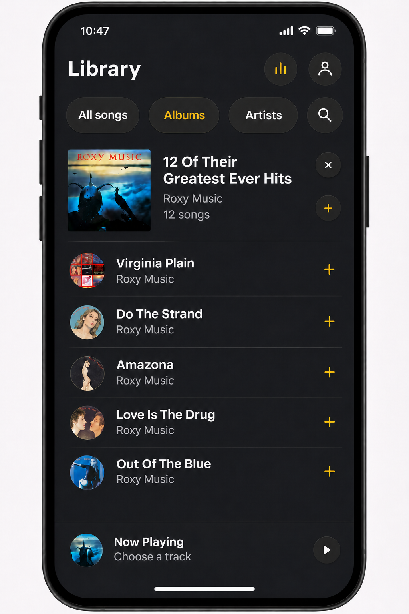
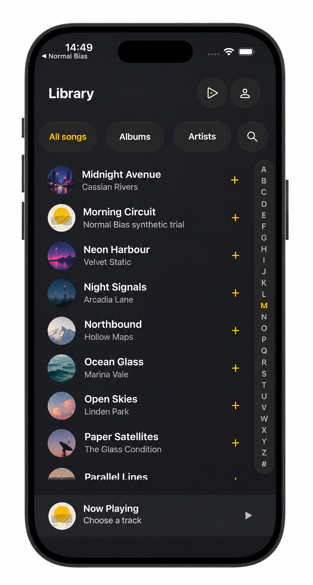
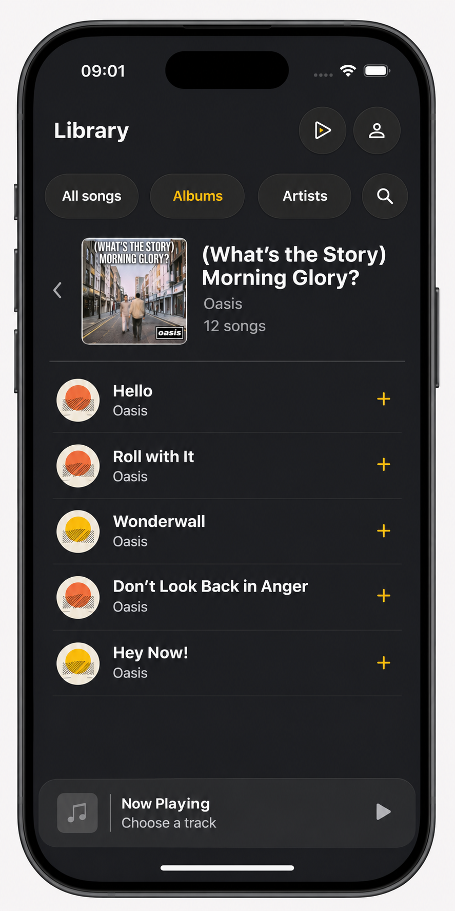
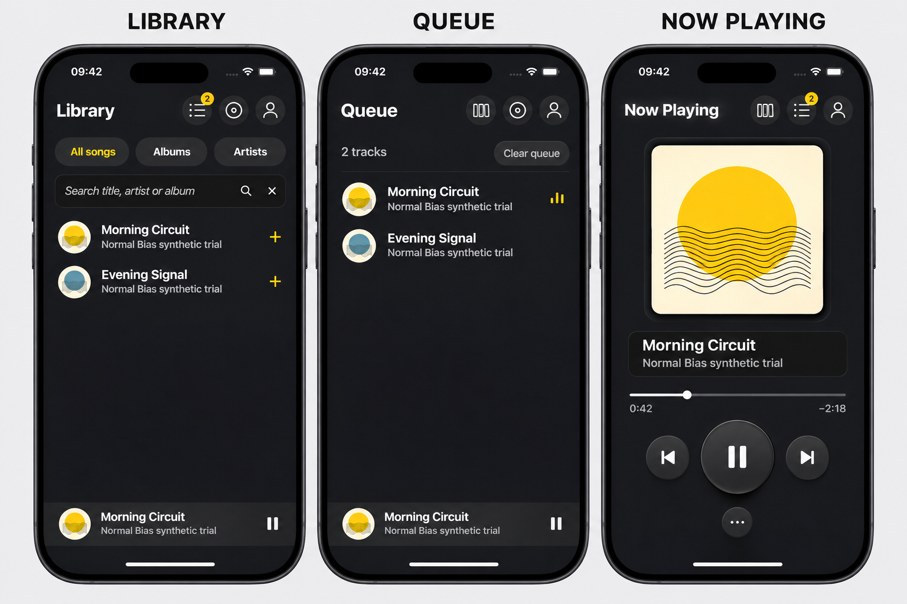
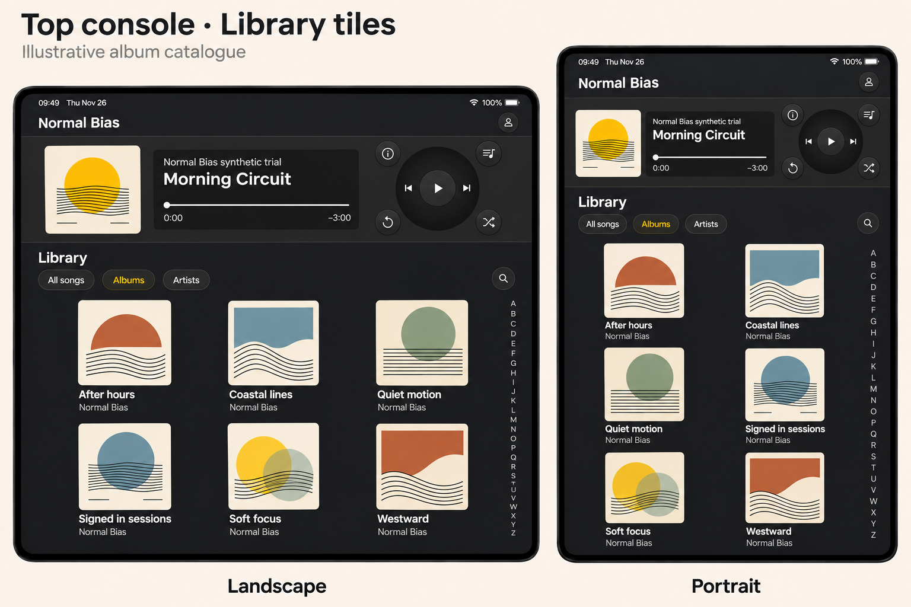
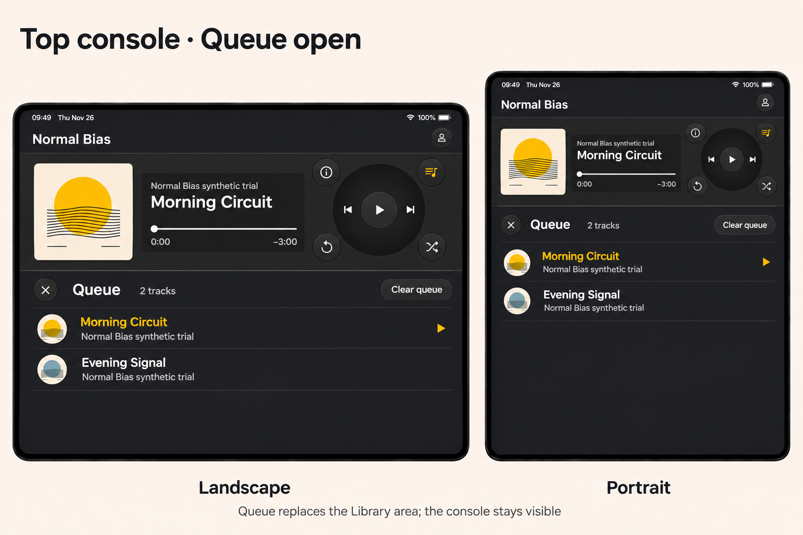
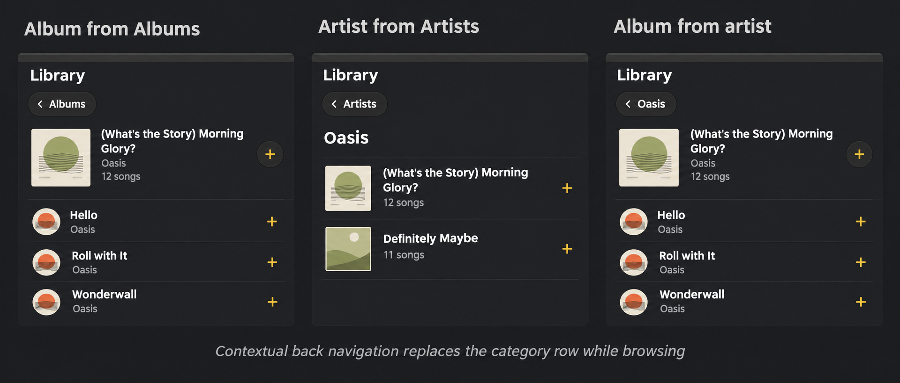
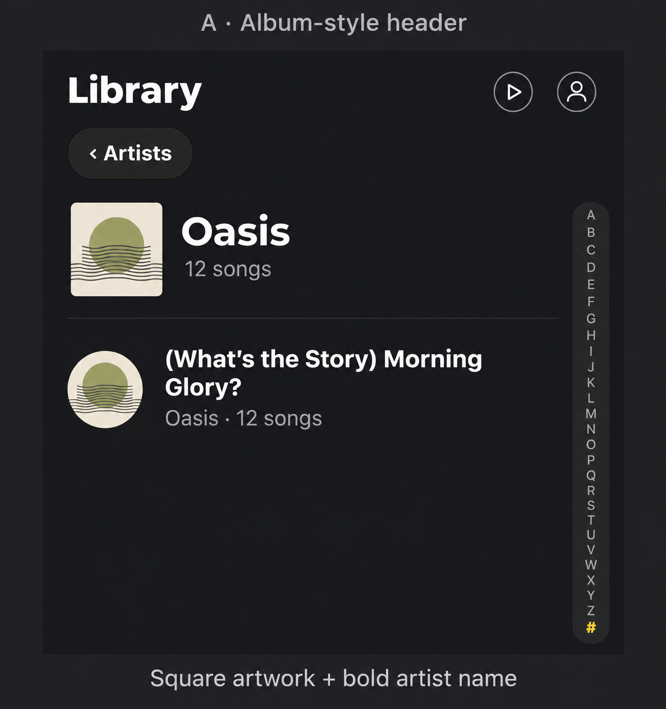

# Normal Bias design reference

Approved design direction, 2026-11-24. This is the canonical design reference for the shared listening application. Read it before planning, changing or verifying UI. The project brief governs product scope; this document governs presentation and interaction consistency. Earlier proposals are historical where superseded here. Reuse the existing Java/Codename One components and pinned 7.0.282 capabilities.

## Principles

Graphite is a tactile personal music device: charcoal surfaces, recessed information wells, a sculpted circular wheel, generous continuous lists and restrained amber details. Artwork supplies most colour. Avoid card-per-track layouts, bright filled transport buttons, unnecessary headings and competing navigation rows. Normal workflows use full-screen views with an explicit way back to their launching context; avoid popups for routine navigation, options and forms. Reserve modal prompts for situations that require an immediate decision. Native conventions apply to fonts, safe areas, keyboard, focus, Back and accessibility; they do not replace the custom player with generic widgets.

Library and Now Playing are the only top-level destinations. On compact windows Queue belongs to Now Playing and is reached through the dedicated player Queue control. In the larger-screen composition the Queue control toggles Queue in place of Library, beneath the persistent console. Use separate destinations on compact windows. At available widths of at least 130 density-aware mm and heights of at least 100 mm, use the horizontal top console and switch the full-width content area between Library and Queue as approved below. Navigation changes presentation only: retain the same player, queue, media resource and Library query/group/scroll state. Do not restart audio merely to change views.

## Established tokens and implementation units

| Role | Established value / convention |
| --- | --- |
| Library / form | `#202124` |
| Player body | `#272727` |
| Artwork recess | `#141414` |
| Search / metadata well | `#171717`, `#3D3D3D` rim, 2.5 mm corner radius |
| Main text | `#F3F3F1` |
| Secondary text | `#B7B8BB` |
| Active detail / keyboard focus | `#EAC23F` |
| Decorative seam | `#111111`; subtle upper graphite edge |
| Disabled text | `#77797B` (hardware controls retain existing `#767676`) |
| Mini-player | `#27282B`, `#353638` upper seam |
| Typography | Native regular / bold; body 2.4 mm, track title 2.3 mm, secondary 2 mm, time/status detail 1.8 mm |
| Spacing | Theme uses density-aware mm: 4 mm horizontal content inset, 2–3 mm control/list rhythm; zero opaque structural-container fill |
| Search | 1.5 mm inset, 1 mm top / 2 mm bottom outside spacing |
| Category pills | Existing moulded `LibraryViewButton`, 3 mm × 2 mm padding, 1 mm margin, 2 mm bold text |
| List artwork | Existing circular `RecordArtwork` thumbnail sizing; reuse across list/queue/mini-player |
| Controls | **Graphite hardware button**: existing restrained moulded hardware painter; white symbols, amber action/selection where specified, separate keyboard-focus indication |

These values reconcile the current theme with the approved Graphite direction. The older 8/12/16/24/32 spacing scale, 40–42 artwork and 72–96 list-row measurements describe reference-image proportions, not literal Codename One pixels. Do not copy raster dimensions or web CSS into the theme. Let rows grow for text. Toolbar controls use at least 9 mm touch regions; visually small icons keep a larger hit region. Verify comfortable 44 pt iOS / 48 dp Android-equivalent targets at the actual platform density, readable contrast and no overlap.

## Graphite hardware button — style named 2026-11-25

**Graphite hardware button** is the shared name for the subtle moulded control already used around the player wheel, especially Restart track. The actual player control is the visual authority. Use its shallow relief: charcoal face `#272727`, fine dark outer seam `#111111` and restrained upper graphite edge `#383838`. The face sits close to its surrounding surface. Keep the edge narrow and low contrast; avoid a thick bevel, bright metallic rim, glossy dome or pronounced drop shadow. The earlier strongly raised concept is superseded by this direction.

Reuse `HardwareButton` / `HardwareButton.paintSurface` for implementation rather than introducing a separate approximation. Preserve the darker pressed treatment, muted disabled glyphs and distinct amber keyboard-focus outline. Glyphs are white for neutral/transport actions; Queue album and Queue artist use amber. Scale the glyph within a comfortable touch region (at least the existing 9 mm convention); do not copy concept-image pixel dimensions. The circular treatment applies to the album/artist Queue + controls and the mini-player play/pause and Next track controls, consistently on Library and Queue. Per-track queue pluses retain their existing unframed treatment. Keep the player wheel and its geometry unchanged. The wheel gradient must also survive button-only focus/press repaints: resolve its origin from the component’s absolute position and the current graphics translation, so transparent transport controls never leave rectangular body-coloured patches.

The larger-view Queue toggle keeps its glyph centred in the same circular bounds in neutral, active, focused and pressed states; opening Queue changes the glyph to amber without moving it.

**Implementation status:** implemented in the shared Java client on 2026-11-25. Album Queue and mini-player play/pause reuse `HardwareButton`; actual checks are recorded in verification. The concept shows the intended control arrangement and restrained finish; generated artwork, other toolbar symbols and raster spacing do not supersede the actual application components.

## Component and navigation conventions

- **Shared fixed toolbar (compact):** contextual title; Library offers Now Playing and Profile. The Now Playing navigation icon is a white outlined play triangle with rounded corners and a small amber centre; retain the moulded circular button and accessible Now Playing name. Now Playing offers Library and Profile; track information belongs to the player artwork area, not the toolbar. Queue has only Back to Now Playing, its title and Shuffle queue; omit Library/Profile on this child screen. No brand/username row, tab strip, bottom navigation, or top-level Queue badge. Keep titles legible and actions named for accessibility.
- **Profile / Account:** Profile opens a full-screen Account view containing a clearly labelled read-only Username well and the existing permitted Change password / Sign out actions. Reuse the Now Playing metadata well: muted Username caption, bold wrapping value, dark inset fill, fine rim and rounded corners. The value is the authenticated username, not a role badge. Omit Close. Its fixed toolbar has Back to the exact launching Library or Now Playing view; returning preserves presentation and playback. Password-change cancellation returns to Account, whose Back still reaches the original launcher. Hide the mini-player on Account without stopping media. Do not expose account controls in demo mode; actions retain the current session callbacks and server affordances.
- **Library:** All songs / Albums / Artists pills and a magnifier toggle share one row. Search starts collapsed; the toggle reveals/hides the full-width recessed field with a Search icon. The category-row magnifier is the sole visibility toggle; omit the search-field Close/Reset ×. Clear a filter by editing the text and submitting an empty query. Opening focuses the editor; collapsing commits editing and preserves both entered text and the applied query/results. Open search or an applied filter keeps the magnifier amber; its accessible action is Show search / Hide search. Switching Library category retains the existing clear-query policy. Selection stays amber independently of focus. Within an artist or album, replace the entire category/search row with one contextual graphite Back pill, as specified below. List art/text inserts a new track immediately after the current queue item and plays it, preserving the upcoming entries for Next and completion. An already queued track plays from its existing position without duplication or reordering. With no current selection, insert at the front; with an empty queue, play the sole item. The amber + appends without interrupting playback (existing entries remain deduplicated). Use the continuous scrolling and alphabet conventions below; retain literal substring search semantics.
- **Now Playing:** reuse `PlayerFace`, `TransportWheel`, artwork, inset metadata, white timeline, times, wheel and all four surrounding controls. Keep navigation in the shared fixed toolbar. The upper-left wheel control (formerly …) toggles track information in place of the artwork; it shows an information icon with accessible name Player information in artwork mode, and a disc icon named Show artwork in information mode. The dedicated Queue control is the sole queue entry point. The lower-left circular-arrow control is Restart track during normal playback: seek to 0:00 on the same current track and preserve playing/paused intent. With no track it is disabled. After a terminal playback failure that same control changes its icon and accessible name to Retry track, reopening the failed stream with the existing recovery policy; ordinary loading/buffering is not failure. While loading, disable this control. After successful recovery restore Restart track. Restarting a completed track leaves it paused at 0:00. The bottom-right wheel control is Shuffle queue, replacing the former Library shortcut; Library/Profile remain in the Now Playing toolbar. Preserve wheel geometry, metadata, timeline and media execution. The two faces share the same artwork bounds and use a short slide transition; track details are read-only, wrapping and independently scrollable when necessary. Display title, artist, album, duration and playback state from the current player snapshot; show a choose-track message when empty. The selected face persists across navigation and queue advancement, with details updating to the new current track. Swapping faces must preserve playback position, intent and the existing media resource. Compact mode retains the bounded vertical player (maximum 62 mm). Larger screens place the artwork/information slot, metadata/timeline and intact wheel assembly side by side in the top console; the wheel assembly remains bounded at 60 mm. Do not flatten or replace the wheel.
- **Queue child screen (compact):** artwork and title/artist rows, persistent current-track indicator distinct from focus, track count and Clear queue. Selecting stays on Queue; clearing stops/releases media, unloads the current track/selection and resets current-track presentation and timing before showing the empty state. Back returns to the player. Top-level Now Playing always opens the player, not the last Queue child screen. Shuffle queue is a one-shot action shared with the bottom-right player control: randomise all current queue entries, preserve the current track by identity at its new index, and retain position, play/pause intent and the same media resource. Previous/Next and completion follow the resulting order; no current selection stays unselected and shuffle does not start playback. Disable Shuffle with fewer than two tracks. This is not a persistent shuffle mode and may randomly retain the same order. Manual reorder/remove and persistent playlists remain outside scope.
- **Mini-player:** existing metadata/artwork with play/pause and Next track on Library and Queue on compact windows. Hide it in the larger-screen composition, where the full transport is already visible. Metadata opens Now Playing. Play/pause and Next track use adjacent circular Graphite hardware buttons, with accessible names. Next follows the existing full-player Next action and queue order; disable it at the queue end or when empty. Keep both touch regions and title/artist within the available width. Remove the orange rectangular title highlight in every pointer/touch state; retain a thin white underline only for keyboard focus, distinct from current-track colour. Hide it on the full player.
- **Collection scrolling and states:** Library fetches automatically near either edge, retains a bounded window and reloads distant rows when scrolling backwards. Omit page numbers, displayed ranges and pagination Back/More. Contextual group Back remains. Preserve loading, empty, no-results and inline failure/retry states; incremental failures retain existing rows. Playback errors remain readable and Retry remains available; do not hide recovery behind a menu.

## First queued track ready to play — approved 2026-11-25

Adding a track or album to an empty queue selects the first queued item and opens it paused at 0:00. Now Playing and the mini-player show that track's title/artwork and enable Play once preparation completes. Preparation uses the normal server playback-grant/media flow; grant renewal on later Play retains existing policy. This does not autoplay. Further queue additions keep the existing selection, stream, position and intent. Clearing the queue unloads both prepared and playing media, resets selection/position/duration, clears current-track presentation and system metadata, disables empty transport controls and ignores late preparation callbacks. This supersedes the earlier no-selection-on-enqueue behaviour; queue storage, order, deduplication and the 200-track limit remain as before.

## Continuous Library and alphabet rail — approved 2026-11-24

All songs sorts by title, Albums by album name, Artists by artist name, and an artist's albums by album name. Tracks inside an album retain their existing catalogue order and scroll continuously without a rail. Names remain literal, including The/A/An; the server compares case-insensitively, folds decomposable Latin accents and supplies deterministic ties. Missing names, numbers, symbols and other initials belong to # after Z. Exact artist/album group identities remain unchanged.

Keep A–Z / # visible in a slender graphite floating rail at the list's right edge, between category/search/context controls and the mini-player. Reserve a gutter so it cannot overlap queue actions. The first visible row determines the amber section, independently of playback and keyboard focus. Missing letters jump forward to the next populated section, falling back to the last populated section. Search uses its own filtered index; empty results disable letter actions. Tap or slide to navigate, showing an enlarged amber letter preview while touching. Each letter also has an accessible Jump to name and keyboard activation; focus remains distinct from persistent section colour. Fit the complete rail to short heights without overlapping fixed controls; reduce glyph line height to each available row when necessary, restoring normal size when space returns. Its compact letter targets are supplemented by the shared slide surface and enlarged preview.

Rows fetch ahead automatically with no displayed pages or range counter. Custom artwork painters prepare immutable sleeve/cover pixels outside active screen painting, intersect ancestor scroll bounds and crop partial bitmaps to the viewport, keeping list sleeves beneath the fixed mini-player. Retain the existing fallback palette/pattern, circular thumbnails and centred, aspect-preserving cover crop; avoid mutable native mask contexts. Five batches of 25 rows bound the live collection; distant rows/artwork are released, and reverse scrolling reloads them while preserving the visible anchor. Top-level navigation preserves the current window. Group Back restores the parent's query/editor and lightweight scroll anchor; category/search changes start at the beginning. The player, queue and audio resource remain independent.

This concept governs rail placement, continuous rows and removal of pagination. Its generated artwork/device proportions are illustrative; existing components and tokens remain authoritative. Implementation and actual verification are recorded in [verification](docs/verification.md).

## Album contents identity header — approved 2026-11-25

Opening an album from Albums, All songs or an artist's album list uses the same compact identity header beneath contextual navigation. Square cover at the left, wrapping bold album title, muted artist and song count in the middle, and a single vertically centred Queue album + Graphite hardware button at the right. The earlier Close × is removed; contextual Back restores the launching collection. Keep the header on the Library surface with a subtle lower seam, without adding a card or album Play control. The representative artwork comes from the existing server-advertised group resource; missing covers retain the original sleeve fallback. Release header artwork when leaving the album and on sign-out. Preserve the track rows, mini-player, queue selection and player geometry. Album tracks have no alphabet rail.

Queue album follows the group's advertised contents and subsequent page links to collect the entire album in server catalogue order, independent of the visible loaded rows. The bounded session queue remains client-side. Append tracks not already queued. When the queue was empty, select its first track and prepare its media paused at 0:00, including title/artwork in Now Playing and the mini-player, so Play works immediately after preparation. Do not autoplay. When a current track already exists, preserve selection, stream, position and play/pause intent. Respect the existing 200-track cap: if the whole addition will not fit, add nothing and show an inline message. Loading disables duplicate submissions, with inline completion/already-queued/error feedback and retry through the same action. Failed/incomplete loads add nothing; contextual Back, switching Library context, clearing the queue or disposing the client cancels a pending addition. Validate advertised playback capabilities in required-auth mode; the server continues enforcing permission and issuing grants at playback time.

The older identity-header and hardware-button concepts record previous navigation arrangements; contextual navigation below supersedes their Back/Close positions. Other raster details do not supersede the existing components. Shared Java implementation and actual browser/native checks are recorded in verification.

## Connection and sign-in — approved 2026-11-24

The landing page is the sign-in page: Service address, Username and Password share one full-screen Graphite form. Use restrained Normal Bias branding and a small decorative record, recessed fields, muted captions/status and amber primary-action text. Bound and centre the form on wide screens; scroll on short screens and respect safe areas, keyboard access, visible focus and density-aware touch regions. Keep connection progress, validation and errors inline rather than switching to a bare waiting/error form.

On startup restore the existing session automatically; a working session opens Library directly. The native address comes from the last successfully discovered service, falling back to the bundled trial/development address; with neither, show the empty service field. The browser derives its address from the page origin. Address edits clear the password. Sign in discovers the selected service before submitting credentials; Retry connection appears after failure and restores the selected service without requiring credentials. Retain sign-in on connectivity failures. Show the retained-sign-in message only when the native client knows a credential exists.

For a different browser endpoint, change the primary action to Open service and disable credential/account-link controls. Navigate to that service’s root-page app in the same tab before collecting credentials; do not carry them through navigation. Native selection connects directly and remembers one HTTPS origin after successful discovery. This page replaces the proposed separate welcome/setup screens; the player and authenticated navigation stay as established above.

## Text input spacing — approved 2026-11-24

Hints use native regular-weight, upright text in the established amber highlight (`#EAC23F`), at the shared 2.2 mm input size; disabled hints use the existing disabled colour. Do not inherit the platform’s italic TextHint font.

All editable text boxes use a 3 mm internal inset on every side, in normal, focused, pressed and disabled states. Hint text and entered text share that inset so neither touches the rim or jumps sideways when typing begins. Apply the shared TextField and TextHint styles to sign-in/service, account/password, account-link and Library search inputs; ConnectionField retains the same 3 mm inset. Codename One 7.0.282 paints TextHint independently across the field bounds, so styling only the field does not pad its hint. Read-only player metadata/status text retains its existing layout.

## Accessibility and responsive checks

Respect safe areas and keep the toolbar outside scrolling content. At short heights scroll rather than compress or overlap player controls. Use native scalable text, wrap long metadata, and preserve accessible action names, keyboard traversal and visible focus. Persistent selection/current-track state must not depend on focus. Do not announce elapsed time continuously. Icon targets and text remain usable at compact, short and wide dimensions; verify with actual generated clients, not concepts alone.

## Visual references and precedence

Written decisions above resolve concept differences. The existing player is authoritative for Now Playing, taking precedence over generated transport alternatives. Reference images are design evidence, not claims of implemented behaviour.

Use the compact toolbar, category pills and full-width search. The concept shows the expanded field; the current field starts collapsed and the category-row magnifier reveals it. The illustrated toolbar Queue icon is superseded: Queue is nested beneath Now Playing.

Use consistent materials, spacing, list and mini-player styling. Queue is a child screen. Do **not** implement the generated Now Playing transport buttons.

Keep this existing player component, circular wheel and four surrounding controls beneath the new toolbar.

## Status and maintenance

Robin accepted the complete UI increment on 2026-11-24 and requested a PR. Approved target: the two-destination navigation and conventions above. Implemented 2026-11-24 after the documentation-first checkpoint. Java client tests, generated-browser navigation/playback/account/artwork checks and native iPhone simulator navigation checks pass; see [verification](docs/verification.md) for exact commands, evidence and limits. The established PlayerFace layout and TransportWheel geometry remain the baseline; the approved refinements change the artwork face/upper-left information action and bottom-right Shuffle action. The inline artwork/information slide was verified in the generated browser client and authenticated iPhone simulator on 2026-11-24; the toolbar information action and duplicate (…) Queue entry are superseded. The simplified Queue toolbar and shared one-shot Shuffle action were also verified in browser and authenticated iPhone simulator on 2026-11-24. Restart with preserved playing/paused intent and failure-only Retry were verified in the browser and authenticated iPhone simulator on 2026-11-24. The previous split desktop/player layout and top-level Queue tabs are superseded targets. Unsupported favourites, repeat, volume, downloads and persistent playlists remain unapproved proposals, not design requirements.

Robin also accepted the unified connection/sign-in and shared input refinements on 2026-11-24 and requested their PR. Service selection, inline retry, the 3 mm field/hint inset and upright regular amber hints are implemented and verified in the generated browser client and isolated iPhone simulator preview. The final shared theme confirms plain hint fonts; native active/inactive password fields were inspected. The existing Done keyboard accessory is retained. See verification for the dated checks, silent recordings and the distinction between Normal Bias Preview and an older retained installed app.

Before UI work, read this document and relevant Codename One references, reuse established components/UIIDs, and check pinned-version capabilities. When a design change is approved, update its rule/rationale and affected examples here in the same change; keep ideas labelled as proposals. Review implementation against this document at handoff, update the client guide and verification record, and deliver required real-client recording evidence. Do not silently treat mockup embellishments as approved functionality.

## Wide-screen composition exploration — requested 2026-11-25

Robin requested multiple concepts showing Library and the existing full player together at larger browser/tablet widths, with mobile unchanged. [Three exploratory concepts](docs/design/wide-layout-concepts/README.md) compare a right-hand player dock, a player-led tablet arrangement and an optional three-pane desktop with Queue. At this exploration checkpoint these were proposals. Robin subsequently selected C as recorded below; A and B remain alternatives. Preserve the actual player/controls and established tokens; generated material/cover/icon differences do not override them. The later C approval below settles the breakpoint, fallback and persistent Queue; the album grid remains unapproved.

## Three-pane listening composition — approved 2026-11-25; superseded 2026-11-26

Robin selected [concept C](docs/design/wide-layout-concepts/c-library-player-queue.png) and authorised implementation for larger screens, including iPad, retaining mobile behaviour. This supersedes the earlier separate-destinations-at-every-width rule and the exploration's pending decision for C. A and B, including B's album grid, remain unapproved alternatives.

At an available width of at least **180 density-aware mm**, show Library, Now Playing and Queue in that order under one compact shared toolbar, with Profile when authenticated. Library and Queue scroll independently; the existing bounded PlayerFace/TransportWheel sits in its own scrolling centre pane, with all four outer actions retained. Use fine dark seams and the established surfaces. Player takes 32% capped at 62 mm; Queue takes 23% with a 48 mm minimum; Library receives the remainder. Compact category pills use their preferred widths in the Library pane. Album identity/search/rail stay within that pane. Queue retains the existing count, Clear and Shuffle actions; no new queue policy, removal or reorder interaction. No duplicate mini-player or top-level view-switch buttons in the combined layout. The wheel Queue control focuses Queue without changing the composition.

Use available window width rather than an iPad/device-name check: resizing, rotation and narrow tablet windows return to the unchanged compact destinations/mini-player when the panes no longer fit. Retain the current requested compact destination, live media resource/position/intent, queue, Library query/group/scroll and artwork/information face while switching composition. Account remains full-screen with Back to its launching context; restore the appropriate composition at the current width. Short wide screens scroll the player rather than shrinking its wheel. Native device and browser measurements, not raster-concept pixels, establish actual fit. Generated album art, filled category pills, metadata styling and transport glyph differences in C do not override existing components.

## All songs album shortcut — approved 2026-11-25

All songs track rows offer a muted album/disc icon immediately before the existing amber + action. Keep the album target at least 9 mm, retain accessible names including the track title and album/artist description, and preserve room for the circular artwork/title pair and alphabet gutter. The shortcut is navigation only: follow the track's server-advertised GET `album` relation and then the returned group's `contents` relation. Show the existing album identity header, complete track list and Queue album control, independent of any song search. Contextual ‹ All songs restores the originating query/editor, search visibility and scroll anchor. Do not add redundant shortcuts inside album contents, on grouped album/artist rows or in Queue. Keep playback/queue intact. Loading/failure feedback stays inline in the Library pane, with retry through the same action; category/view changes or disposal cancel stale navigation. Omit the icon if the service does not advertise the relation. Both compact and combined layouts use this convention.

## Horizontal top console and group tiles — approved 2026-11-26

Robin selected the horizontal-console exploration with Library tiles and open/close Queue, then approved implementation with denser **Albums and Artists** grids. This supersedes the three-pane composition above; its approval and verification remain historical. Compact mobile destinations, mini-player, vertical PlayerFace and TransportWheel geometry/actions are unchanged.

Use the larger composition when the available Form width is at least **130 density-aware mm** and height at least **100 mm**, permitting iPad portrait as well as landscape without a device-name check. Below either limit retain compact navigation. Under the shared Normal Bias/Profile toolbar, the same live PlayerFace rearranges its artwork/information slot, metadata/timeline and existing wheel horizontally. The wheel assembly is bounded at 60 mm and retains its proportions and all four surrounding buttons; artwork is bounded at 40 mm. Metadata omits its duplicate thumbnail in this composition. Bound the console viewport to 48% of Form height with a 45 mm minimum; scroll its contents for long metadata/status rather than clipping controls. Account remains full-screen.

The full-width region below defaults to Library. The wheel Queue button toggles this region to Queue and is amber while open. Queue offers Close, count, Clear and the existing Shuffle action; Close or the wheel Queue button restores Library's query/group/scroll. Clear retains the open empty Queue. Opening Queue suspends speculative Library artwork/prefetch without discarding its bounded collection. Account Back, resizing and rotation retain presentation and media state; compact Queue retains Back to Now Playing.

Albums, Artists and an artist's albums use square representative covers with wrapping title and existing secondary metadata below, no enclosing card or new tile action. Tile activation follows the existing advertised contents relation. All songs and album contents remain continuous track lists with existing play/album/queue controls. Retain search, alphabetical ordering/rail, accessible names and keyboard focus. Reserve the rail gutter. Aim for **five landscape/four portrait columns** on the reference tablet: a 28 mm minimum tile, approximately 3 mm gutters, maximum five columns through 240 mm Form widths, further columns on wider desktops. Larger text reduces columns. These are density-aware fit rules, not browser CSS pixel breakpoints. Preserve the visible group identity on list/grid reflow, bound loading to five 25-item batches and release distant artwork.

**Implementation status:** implemented in shared Java on 2026-11-26; generated-browser and isolated iPad/iPhone simulator checks are recorded in verification.

These generated references use illustrative albums and lower tile density. Written density rules and the actual retained wheel/components take precedence. The implementation and actual checks/limitations are recorded in verification; generated controls and album names are not new functionality or catalogue content.

## Contextual Library navigation — approved 2026-11-26

At Library roots retain All songs / Albums / Artists and the search magnifier. Inside an artist or album, replace this entire row with one left-aligned graphite pill: ‹ Albums, ‹ Artists, ‹ artist name, or ‹ All songs for the track-row album shortcut. Use the immediate history parent, not the selected category alone. Remove separate breadcrumb/back controls and album Close ×. Keep the artist heading and album identity metadata; Queue album + is vertically centred beside the album header.

Reuse LibraryViewButton with neutral white text, at least 9 mm height and the established focus treatment. Bound long artist labels to the available width with ellipsis; accessible Back to names retain their full text and Unknown artist fallback. Child views hide search and its editor. Back restores the parent's query, editor text, search visibility and scroll anchor. Compact and larger layouts share this behaviour; Queue/Account transitions and resizing retain the context. Back cancels pending album queueing through the existing context-change mechanism and leaves active media and queue unchanged.

Implemented in shared Java; actual checks and limitations are recorded in verification. Generated album-list queue pluses in the middle concept pane are illustrative and do not authorise new grouped-list actions. The earlier Close/Queue layout is historical; the existing player remains authoritative.

## Artist identity header — option A approved 2026-11-26

On an artist's album list, replace the small muted artist label with a compact identity header beneath ‹ Artists. Reuse the album header's flat Library surface, square 18 mm artwork, spacing and subtle lower seam. Beside the artwork show a bold wrapping artist name in native bold at 3.3 mm (ArtistHeading), with the server artist group's song count in muted text below; centre the copy vertically beside the cover. Queue artist + sits vertically centred at the right, as specified below. The album list/grid and its alphabet rail remain beneath the header, clear of it.

Use the selected artist group's existing representative track/artwork capability, retaining the generated sleeve when absent/unavailable; this is library artwork, not an artist portrait or new external lookup. Keep that small group snapshot in navigation history so Album → artist Back restores the same identity/count. Release header artwork on leaving the artist list or disposal, refresh through the existing artwork lifecycle, wrap long/missing names (Unknown artist) and remeasure on resize. Preserve parent search/scroll, playback and queue behaviour across compact/larger layouts. The current album header and player remain unchanged.

Option B's recessed artist panel remains an unselected proposal. The selected generated concept governs the square-art/name/count arrangement; actual component spacing, toolbar icons and alphabet rail remain governed by the written conventions. Shared Java implementation and actual checks are recorded in verification.

## CarPlay adaptation — authorised 2026-11-26

Apply the shared principles through the platform's system templates. Library and Now Playing are the only home destinations. Library offers All songs / Albums / Artists; grouped rows show name, artist where relevant and song count. Root collections use server alphabetical affordances; album contents follow advertised contents links in catalogue order. Artwork comes from the existing API/cache, with at most one 25-item page of thumbnail references per active collection. Queue and portable Now Playing also show artwork, bounded to their visible tracks. Missing art leaves a clean native text row; do not introduce another artwork provider or draw the phone's custom components into template images.

Artist → albums → songs uses contextual Back to the named parent, preserving its loaded page/window. These collection steps share one native template stack slot, keeping Home → Library → collection → Now Playing → Queue/System player within five slots. The system Back exits the collection to categories; contextual Back retraces artist/album context. Selecting a song uses the shared insert-and-play action. Playback navigation preserves the collection; no new media session is created.

Now Playing displays title and secondary artist/album metadata, shared Play/Pause, adjacent-track actions and Restart. Loading shows inline status and withholds Play/Restart; terminal failure exposes Retry track. Header actions open Queue and System player (Apple's Now Playing template). Queue is a child, with count, a persistent Playing/Paused/Loading/Playback failed prefix distinct from focus, conditional Shuffle queue, and Clear queue. Selecting stays on Queue; Back returns to Now Playing. Shuffle preserves the shared current track/media/intent; Clear unloads it. No account or sign-in forms in the car: reconnect/account administration belongs on the phone.

**Platform exceptions:** CarPlay owns surfaces, font sizing, colours, focus highlights, touch regions and Back chrome. Graphite palette, moulded buttons, circular thumbnails, wheel geometry, inset wells, animations and phone/desktop console layouts do not transfer to these templates. Do not force amber selection or charcoal surfaces with generated images or replace the system player. Native conventions take precedence on the head unit. The pinned Java/native bridge supports list images and header actions, but does not wire custom `CarNowPlayingTemplate` actions or Up Next callbacks; keep Queue accessible from the portable Now Playing header. The desktop renderer omits header strips, so it uses visible Queue/Shuffle rows and More controls → Back to Now Playing for secondary transport/System player actions, capped at five control rows. The desktop launchers explicitly select this row fallback; iOS retains the native header arrangement. The desktop System player is a placeholder, not an Apple UI preview.

Finite head-unit row limits require explicit Earlier / More actions rather than continuous scrolling or an A–Z rail. Reserve space for contextual Back and paging; no page counters. Search, per-song append, whole-album queueing and account editing remain in the phone client for this adaptation. Their absence is a bounded car interaction choice, not a change to shared playback/queue policy. Do not add persistent shuffle, a car queue or client-side authorisation rules.

**Implementation status:** Java template adaptation implemented; desktop renderer/callback checks and recording are documented in [verification](docs/verification.md). The pinned native bridge also needs system-Back stack synchronisation and image-registry lifetime validation; Java thumbnail bounds do not establish native memory bounds. Apple simulator/head-unit presentation, touch/rotary accessibility and runtime acceptance remain blocked by the existing entitlement/signing gate. This does not authorise account/profile changes, membership purchases, retained-service updates or device installation. Apple's [CarPlay guidance](https://developer.apple.com/design/human-interface-guidelines/carplay) and [template documentation](https://developer.apple.com/documentation/carplay/) define the platform presentation boundary.

### Artist queue action — approved 2026-11-26

The artist identity header offers Queue artist using the same 9 mm Graphite hardware + as Queue album, vertically centred at the right. Follow the artist group's advertised GET `tracks` relation and subsequent pages in server catalogue order, spanning all albums. Reuse album queue semantics: deduplicate, bounded atomic loading, 200-track cap, inline loading/result/error feedback, cancellation on context change/Back or Clear queue, paused preparation when empty and preserved current media otherwise. Disable the action when the service omits the relation. Preserve the artist link through Album → artist Back. No artist Play control is introduced.
