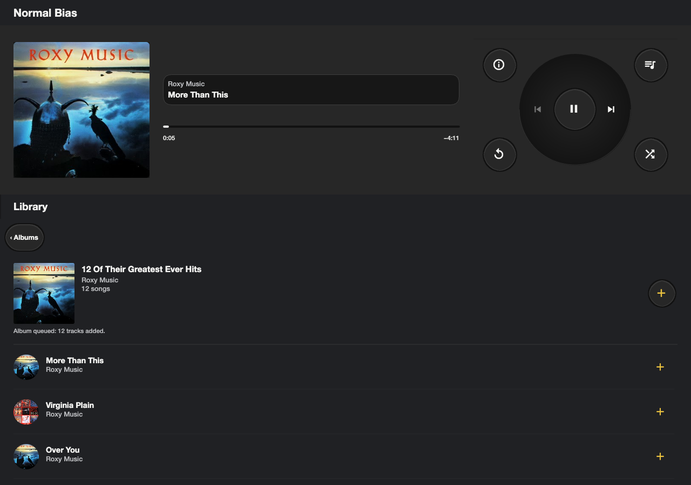
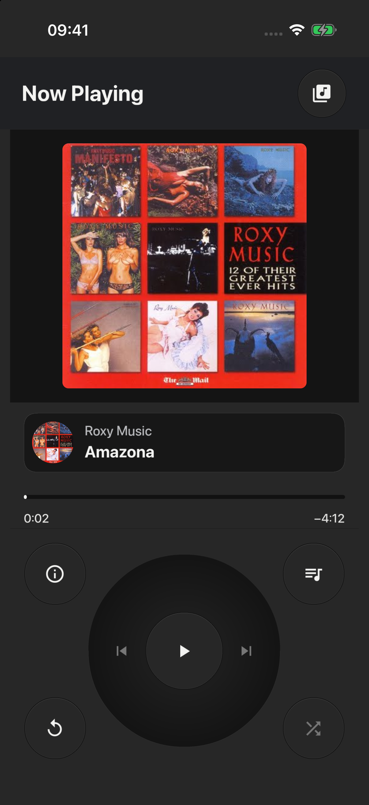
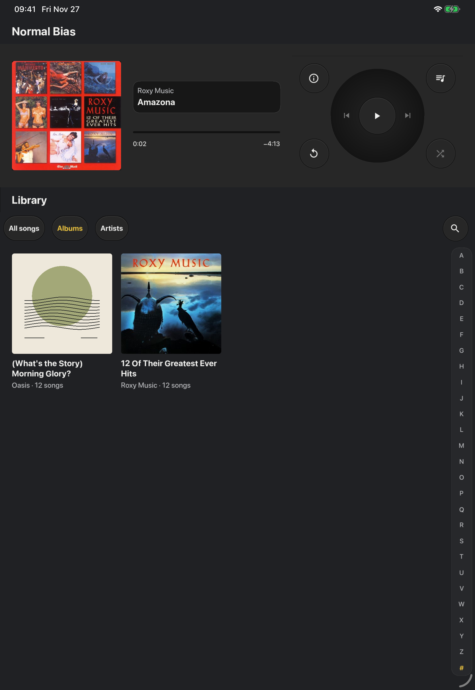
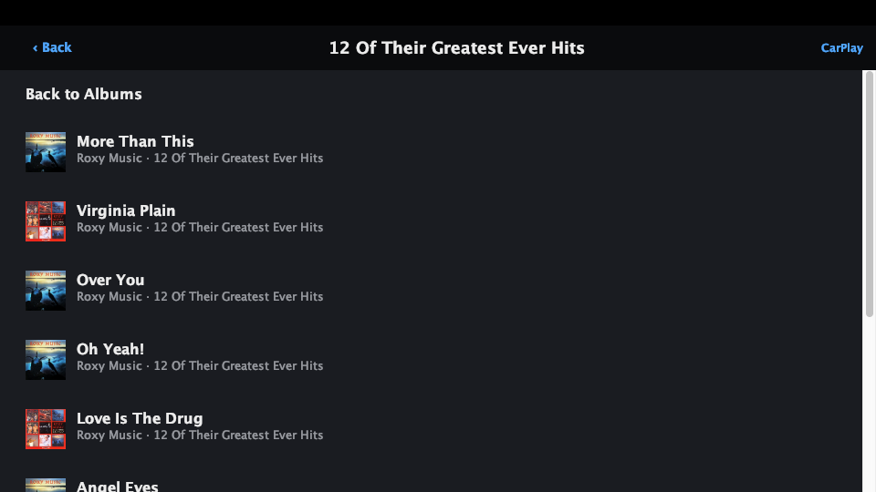

# Normal Bias

A self-hosted music service for your MP3 collection, with a tactile, iPod-inspired player. Browse albums and artists, find a song, and build a listening queue—on the web or in the shared Java client.

Normal Bias is a working proof of concept built with Java, Spring Boot and Codename One. You bring the music and run the service; your catalogue and MP3 files live alongside it.



**[Try it locally](#try-it-locally)** · **[Use your own music](#use-your-own-music)** · **[Build and explore](#build-and-explore)**

## See the app

| iPhone | iPad |
| --- | --- |
|  |  |
| Full-size Now Playing · iOS simulator | Player and library together · iPadOS simulator |



*CarPlay prototype — desktop simulator. This is the framework’s head-unit renderer; Apple’s native CarPlay layout and real-car operation remain unverified.*

These are actual application captures using a locally imported music collection. Music files are not included in the repository; the quick demo below supplies original synthetic clips. Capture details and reproduction steps are in the [demo guide](docs/demo.md).

## What you can do

- Browse songs, albums and artists with continuous scrolling, alphabetical jumps and search.
- Play, pause, seek and move between queued tracks; queue a song, album or artist, and shuffle the current queue.
- See embedded album covers, with automatic background lookup for missing artwork in normal service operation.
- Import an MP3 directory using the Java uploader, with exact-file deduplication.
- Run an authenticated service with owner/listener accounts, remembered sessions and scoped playback URLs.

### Current status

| Area | Status |
| --- | --- |
| Browser | Working listening client; local playback and desktop installed-app checks recorded. |
| iPhone / iPad | Native builds and simulator checks recorded; some physical iPhone playback has been tested. Full physical authenticated/background/interruption acceptance remains open. |
| CarPlay | Experimental Java prototype verified in the desktop head-unit renderer. Native signing/entitlement and runtime acceptance remain open. |
| Hosting | Local development supported; initial authenticated Tailscale HTTP hosting selected. Public deployment and backup/restore remain unfinished. |

Currently MP3-only, with a session-local queue capped at 200 tracks. Persistent playlists and offline music are not implemented. The service uses a single-instance H2 catalogue and local file storage. See the dated [verification record](docs/verification.md) for evidence and platform limits.

## Try it locally

You need **Java 21 JDK**, **Maven 3.6.3+**, **Bash**, **Python 3**, **unzip**, **curl**, and **FFmpeg/FFprobe**, plus internet access for the first build. Check that both `java -version` and `mvn -version` report Java 21.

Clone this repository, enter its directory, then run:

```sh
./client/demo-web.sh
```

The helper builds the API, uploader and browser client, creates two original synthetic musical clips with covers, and starts a disposable library. The first build can take several minutes while Maven and Codename One download their tools; no Codename One account or cloud build subscription is needed.

When the terminal prints **Normal Bias is ready**, open **http://127.0.0.1:18080/**. Choose a song to play, or open **Albums → Simulator Sessions → Queue album +**, then press Play. No sign-in is needed for this loopback-only demo.

Keep the terminal open. **Ctrl-C stops the service and deletes the temporary library.** The helper leaves build output and downloaded tool caches for later runs. It uses a separate data directory, disables external artwork lookup, and refuses an occupied port. For another port:

```sh
NORMALBIAS_DEMO_PORT=18081 ./client/demo-web.sh
```

To try your own MP3s in the same disposable demo:

```sh
NORMALBIAS_DEMO_MUSIC_DIR="/absolute/path/to/music" ./client/demo-web.sh
```

This imports copies through the API and preserves your source files. Its temporary library is still deleted when stopped.

This demo is available only on the computer running it. For setup, troubleshooting and capture instructions, see the [demo guide](docs/demo.md).

## Use your own music

For an enduring library, follow the [authenticated service setup](docs/authentication.md) to create an owner, configure storage and issue an upload credential. Then use the [directory uploader](docs/authentication.md#authenticated-uploader) to import MP3s and sign into the listening client. The [client guide](docs/client-poc.md) explains building and serving the browser app from the API’s origin.

Authentication is required by default. Initial hosting is intended for Tailscale with HTTP; HTTPS enforcement is configurable. The uploader currently connects through loopback, so run it on the service host. Data is stored under `./data` unless configured otherwise. Demo libraries are temporary: do not use the quick demo for a collection you want to keep.

Public hosting, backup/restore and native distribution are still development work. See [storage reliability](docs/storage-reliability.md) for migrations, recovery and online inspection.

## Build and explore

The project has three main pieces:

| Piece | Location | Purpose |
| --- | --- | --- |
| API | `api/` | Spring Boot, H2 catalogue, authentication and MP3 storage/streaming. |
| Uploader | `cli/` | Java command-line directory import through the API. |
| Listening client | `client/` | Shared Java/Codename One UI, translated locally for the browser. |

With Java 21 selected, run from the repository root:

```sh
mvn clean verify          # API and uploader, including tests
./client/build-web.sh     # Separate client reactor, tests and browser bundle
```

Client common sources target Java 17; the builds use JDK 21 and pinned Codename One 7.0.282. The root Maven reactor does not build the client. Browser playback uses a documented narrow JavaScript audio bridge; UI, API access and queue policy remain Java.

Start with the [local API/CLI guide](docs/local-poc.md) and [web client guide](docs/client-poc.md). For a desktop simulator with a disposable library, use `./client/demo-simulator.sh` and the [simulator guide](docs/simulator-poc.md).

## Further documentation

- [Project brief, agreed constraints and open decisions](docs/project-brief.md)
- [Canonical application design reference](DESIGN.md)
- [Authentication and local administration](docs/authentication.md)
- [Album artwork](docs/album-artwork.md)
- [Storage migrations, recovery and online inspection](docs/storage-reliability.md)
- [Local iPhone trial](docs/local-device-trial.md)
- [CarPlay prototype and signing gate](docs/carplay-poc.md)
- [Verification history and platform limitations](docs/verification.md)
- [Instructions for coding agents](AGENTS.md)
